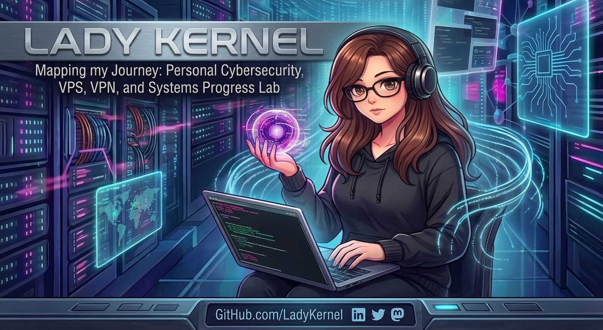

<p align="center">
  
</p>

# 🛡️ MyIronGuard

<p align="left">
  
  
  
  
  
  
  
</p>

> **Secure by design. Built by LadyKernel.**  
> Bienvenido/a a **MyIronGuard**. Este repositorio documenta la arquitectura, despliegue y fortificación de mi infraestructura personal de red y VPN en un VPS Linux (Google Cloud Platform).  
> El objetivo principal es disponer de un entorno seguro, privado y bajo control absoluto, utilizándolo como nodo operativo y laboratorio técnico para aplicar ciberseguridad defensiva, bastionado integral y administración avanzada de sistemas.

---

## 🛠️ Ecosistema y Proyectos Destacados en Producción 🚀

El repositorio articula la configuración del sistema host y herramientas operativas en entornos reales:

| Módulo / Proyecto | Tipo | Descripción | Estado |
| :--- | :--- | :--- | :--- |
| **Infraestructura & Bastionado** | Core Host / Hardening | Parámetros de kernel sysctl, control de acceso SSH, túneles VPN y filtrado perimetral. | `Producción / Activo` |
| **[Network Monitor CLI](./network-monitor)** | Herramienta CLI (Bash) | Monitor de tráfico en tiempo real con vnStat, alertas a Telegram y módulo FinOps. | `v1.1 (Estable)` |
| **[Dskwap Guardian CLI](./dskwap-guardian)** | Herramienta CLI (Bash) | Monitor preventivo de almacenamiento raíz (`/`) y memoria SWAP con simulación de limpieza y alertas Telegram. | `v1.0 (Estable)` |

### 📊 [Network Monitor CLI (FinOps & Anti-DDoS)](./network-monitor)
Una herramienta ligera y eficiente para monitorear el tráfico de red en servidores Linux utilizando **vnStat** y con notificaciones automáticas integradas a **Telegram**:
- **Control de Costes (FinOps):** Calcula automáticamente el gasto estimado basado en el tráfico de salida (*Egress*), ideal para proteger el Free Tier de GCP o AWS.
- **Seguridad Defensiva:** Funciona como alarma Anti-DDoS y detección de anomalías al detectar picos de tráfico inusuales en tiempo real.
- **Estado:** En producción activa.
- 👉 **[Ver código y guía de instalación detallada aquí](./network-monitor)**

### 🧹 [Dskwap Guardian CLI (Storage & SWAP Resilience)](./dskwap-guardian)
Una utilidad SysAdmin de cero dependencias diseñada para proteger instancias VPS con discos ajustados frente a caídas por saturación de almacenamiento o memoria SWAP:
- **Control Human-in-the-Loop:** Audita disco raíz (`/`) y `SWAP` vía `cron`, envía a Telegram la simulación exacta del espacio recuperable y entrega el comando listo para ejecutar manualmente (`--limpiar`).
- **Mantenimiento Seguro:** Trunca logs activos pesados (`truncate -s 0`) sin romper descriptores de procesos en ejecución, limpia logs rotados antiguos, `systemd-journald` y caché `apt`, registrando auditoría local autorrotativa.
- **Estado:** En producción activa.
- 👉 **[Ver código y guía de instalación detallada aquí](./dskwap-guardian)**

---

## 🏗️ Arquitectura de Red y Flujo de Telemetría

```text
[ WAN: Tráfico Externo / Internet ]
           │
           ▼
[ Capa Perimetral: Firewall UFW / iptables + CrowdSec / Fail2Ban + sysctl Hardening ]
           │
           ├──────────────────────────────┬──────────────────────────────┐
           ▼                              ▼                              ▼
  [ WireGuard VPN ]              [ SSH Bastionado ]           [ Motores de Telemetría ]
  (Acceso Privado)               (Solo Clave / No Root)       (vnStat + Kernel Disk/SWAP)
           │                              │                              │
           └──────────────┬───────────────┘                              ▼
                          ▼                                   [ Suite CLI MyIronGuard ]
           [ Servicios Internos / Sandbox ]                              │
                                                        ┌────────────────┴────────────────┐
                                                        ▼                                 ▼
                                             [ Network Monitor CLI ]           [ Dskwap Guardian CLI ]
                                             (Anti-DDoS & FinOps)              (Disk/SWAP & Log Audit)
                                                        │                                 │
                                                        └────────────────┬────────────────┘
                                                                         ▼
                                                                [ Telegram Bot API ]

---

```

---

## 🎯 Objetivos del Proyecto

* **Laboratorio Técnico:** Disponer de un entorno dedicado y propio para diseñar, validar y desplegar configuraciones avanzadas de Linux, redes y seguridad.
* **Conectividad Segura:** Configurar una VPN funcional y de alto rendimiento (**WireGuard**) para tunelizar y cifrar todo el tráfico administrativo de forma privada.
* **Hardening del Servidor:** Reducir drásticamente la superficie de ataque mediante políticas restrictivas en red, sistema operativo y parámetros de bajo nivel.
* **Gestión de Infraestructura:** Administrar servicios, túneles y reglas de filtrado en entornos cloud remotos con enfoque de alta resiliencia.
* **Aprendizaje Continuo y Experimentación:** Utilizar este nodo operativo como sandbox para experimentar, auditar y reforzar conocimientos técnicos en ciberseguridad defensiva.

---

## 🛠️ Tecnologías Utilizadas

* **Sistema Operativo:** Ubuntu Server 24.04 LTS / Debian (VPS en Google Cloud Platform).
* **Conectividad & VPN:** WireGuard VPN, Cloudflare Tunnels.
* **Control de Acceso:** SSH bastionado mediante autenticación exclusiva por par de claves públicas asimétricas.
* **Seguridad Defensiva & Perímetro:** UFW (Uncomplicated Firewall), iptables, Fail2Ban, CrowdSec y hardening de kernel Linux (`sysctl`).
* **Monitorización, FinOps & Alertas:** vnStat Core Engine, Shell Scripting (Bash modular POSIX), Telegram Bot API.

---

## 🔐 Medidas de Hardening Aplicadas

Para garantizar la integridad, confidencialidad y aislamiento del entorno, se han implementado capas de defensa en profundidad:

### 1. Acceso SSH Restringido e Identidad
* Desactivación estricta de autenticación por contraseña (`PasswordAuthentication no`).
* Prohibición absoluta de acceso directo al usuario root (`PermitRootLogin no`).
* Migración del servicio SSH a un puerto alternativo no estándar para mitigar escaneos masivos.
* Autenticación exclusiva mediante claves criptográficas seguras (Ed25519 / RSA 4096).

### 2. Gestión Perimetral de Puertos y Firewall
* Política de cierre estricto por defecto (`DROP` / `DENY` entrante) en puertos no esenciales.
* Reglas de firewall específicas y acotadas para el puerto de negociación de la VPN WireGuard.
* Coordinación de UFW con agentes activos (**CrowdSec** y **Fail2Ban**) para baneo automático de IPs maliciosas y prevención de fuerza bruta.

### 3. Aislamiento de Red y Privacidad
* Configuración del túnel VPN para que solo el tráfico previamente autenticado y autorizado alcance los servicios internos y el sandbox.
* Aislamiento de red para evitar la exposición directa de sockets locales a interfaces de red públicas.
* Mitigación de fugas de resolución (**DNS Leaks**) mediante el uso forzado de resolvers DNS cifrados y privados dentro del túnel.

### 4. Hardening de Kernel (`/etc/sysctl.conf`)
* **Protección Anti-DoS:** Activación de TCP SYN Cookies (`tcp_syncookies = 1`).
* **Anti-Spoofing:** Verificación de ruta inversa estricta (`rp_filter = 1`) en todas las interfaces de red.
* **Higiene de Red:** Descarte automático de peticiones ICMP broadcast y rechazo de paquetes con enrutamiento de origen (`accept_source_route = 0`).

---

## 💡 Retos y Aprendizajes

El mantenimiento de este nodo en producción permite consolidar áreas clave de la ingeniería de sistemas:
* **Enrutamiento y NAT:** Configuración avanzada de interfaces virtuales, reglas de reenvío y traducción de direcciones de red para el tráfico del túnel.
* **Seguridad Defensiva en Linux:** Implementación práctica de arquitecturas defensivas en capas (*Defense in Depth*).
* **Gestión de Servicios y Logs:** Depuración en tiempo real, análisis de trazas de autenticación y automatización de respuestas ante incidentes.
* **Buenas Prácticas de Hardening:** Aplicación de estándares reconocidos para la reducción sistemática de la superficie de ataque.
* **Arquitectura Cloud & FinOps:** Control analítico del tráfico de salida (*Egress*) para optimizar recursos en nubes públicas sin sobrecostes.

Un entorno real, funcional y documentado, diseñado para responder a requerimientos estrictos de seguridad y control operativo.

---

## 👩‍💻 Sobre mí

Soy **LadyKernel**, profesional con más de 18 años de trayectoria en el sector tecnológico gestionando infraestructuras críticas, sistemas Unix/Linux y middleware corporativo en entornos de producción de alta exigencia.

Actualmente aplico toda esa base operativa en la **ciberseguridad defensiva**, el **bastionado de sistemas** y la **automatización de infraestructura cloud**, construyendo entornos robustos, privados y bajo control absoluto.

* 🌐 **Portfolio & Web:** [www.lksys.es](https://www.lksys.es)
* 🐙 **GitHub:** [github.com/LadyKernel](https://github.com/LadyKernel)
* 💼 **Especialidad:** SysOps, Linux Systems & Defensive Security
* ✉️ **Contacto:** [hola@lksys.es](mailto:hola@lksys.es)

*«Siempre construyendo, siempre asegurando, siempre aprendiendo.»*

---

## 🛡️ Licencia y Uso Comercial

Este proyecto se distribuye bajo la licencia **PolyForm Noncommercial License 1.0.0**.

* **Uso Comunitario:** Eres libre de usar, modificar y estudiar esta arquitectura para entornos personales y formativos.
* **Uso Profesional:** El uso en entornos corporativos o fines comerciales requiere autorización específica. Para detalles legales, consulta el archivo `LICENSE`.
